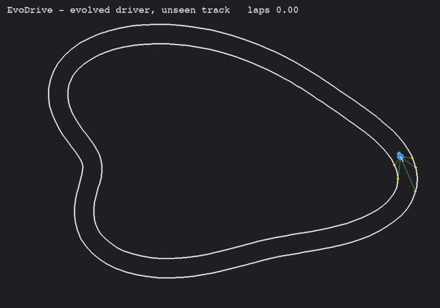

# EvoDrive

**Cars that teach themselves to drive with a genetic algorithm. No labeled data, no ML libraries — just NumPy, Pygame, and a fitness score.**



*An evolved driver lapping a randomly generated track it never trained on. Green lines are its 5 distance sensors. (The demo track was chosen so the clip shows a full lap; success rates across 100 tracks are in the results below.)*

## Results

Each evolved driver was trained for 45 generations (50 cars) and then tested on **100 fresh random tracks** it never saw during training or model selection. Numbers are from 3 independent training seeds.

| Driver | Normal test tracks | Harder "stress" tracks (never trained on) |
|---|---|---|
| Hand-written rule-based driver | 51% | 8% |
| **Evolved neural network** (3 seeds) | **97%** (96–97%) | **76%** (72–83%) |

*"Completed" = finished at least one full lap without crashing. Stress tracks have a 36 px road instead of 44 px and sharper bends.*

On the same tracks, the evolved driver went further than the rule-based driver on 88–97% of them.

### Which training settings matter? (3 seeds each)

| Setting | Normal | Stress |
|---|---|---|
| Baseline (2 tracks/generation, mutation rate 0.1, strength 0.4) | 97% (96–97) | 76% (72–83) |
| 4 tracks/generation (2× training time) | 97% (96–97) | 78% (70–82) |
| Low mutation (0.05 / 0.2) | 94% (90–100) | 43% (19–62) |
| High mutation (0.2 / 0.8) | 97% (91–100) | 29% (22–43) |

What I learned:

- **An easy benchmark hides real differences.** On normal tracks every setting scored 91–100%. Only the harder stress test separated them (29% to 78%).
- **Both mutation extremes hurt robustness.** Their best seeds scored below the baseline's worst seed on the stress test.
- **Doubling training tracks per generation didn't help** — 78% vs 76% with overlapping ranges, for twice the compute. I expected it to help (less noisy fitness), and the data didn't support that.

## How it works

1. **Sense.** Each car casts 5 rays (at −60°, −30°, 0°, 30°, 60°) and measures the distance to the nearest wall, up to 200 px. All ray-wall intersections are computed at once with NumPy broadcasting.
2. **Think.** A tiny neural network — 5 inputs → 6 hidden neurons (tanh) → 2 outputs (steer, throttle) — has just **50 parameters**.
3. **Act.** The car steers and accelerates; touching a wall ends its run.
4. **Score (fitness).** Progress around the track's centerline, in laps, capped at 2. Driving backwards counts as negative progress, and cars that stall are stopped, so circling in place can't earn points.
5. **Evolve.** The 50 parameters are treated as the car's "DNA." Each generation keeps the top 3 unchanged (elitism), breeds children from the top 25% (uniform crossover), and randomly nudges ~10% of each child's numbers (Gaussian mutation).

Every generation trains on **brand-new random tracks**, so drivers can't memorize a layout — they have to read their sensors.

### Honest evaluation: three separate sets of tracks

| Set | Purpose |
|---|---|
| Training tracks (new each generation) | compute fitness |
| 8 fixed validation tracks (seed 12345) | choose which car to save |
| 100 test tracks (seed 2024) | the final score above |

Validation scores reached 100% for every seed, but the held-out test showed 96–97% — validation is biased upward because it was used to pick the winner, so it isn't reported as the result.

## Quick start

```bash
python3 -m pip install -r requirements.txt
python3 check_setup.py                          # 9 automated checks
python3 train.py --seed 1 --out runs/seed1      # ~70 s on an M-series Mac
python3 drive_best.py --file runs/seed1/best_network.npy   # watch it (N = new track)
```

### Reproduce the results

```bash
python3 train.py --seed 1 --out runs/seed1
python3 train.py --seed 2 --out runs/seed2
python3 train.py --seed 3 --out runs/seed3
python3 compare.py                               # normal tracks
python3 compare.py --half-width 18 --wobble 4    # stress tracks
python3 experiments.py                           # settings comparison (~20 min)
python3 plot_history.py runs/seed1/history.csv   # training curves
```

Runs are deterministic: the same seed gives the same result on the same machine. Different machines can differ slightly (tiny floating-point differences change evolution's path), which is one reason results are reported over several seeds.

## Project structure

| File | What it does |
|---|---|
| `network.py` | the 50-parameter neural network, written with plain NumPy |
| `evolution.py` | selection, elitism, crossover, mutation |
| `track.py` | random smooth closed-loop tracks, with a validity check |
| `car.py` | physics, vectorized ray-cast sensors, collisions, lap progress, rule-based baseline |
| `train.py` | the training loop; logs `history.csv`, saves `best_network.npy` and `config.json` |
| `compare.py` | evolved vs rule-based driver on held-out test tracks |
| `experiments.py` | trains each setting × seed and scores it on normal and stress tests |
| `plot_history.py` | training curves from `history.csv` |
| `drive_best.py` | watch a trained driver live |
| `record_gif.py` | records the demo GIF |
| `check_setup.py` | automated checks for the whole project |
| `main.py`, `demo_random.py` | early prototypes: manual driving on a fixed track, and 50 random networks |

## Limitations

- **Small experiments.** 3 seeds per setting and 100 test tracks per test (a standard error of roughly 2–5 percentage points per number, so small differences are noise).
- **Simple world.** One car, no traffic or obstacles, simplified physics, and perfect noise-free sensors.
- **The baseline is simple.** The rule-based driver is a short hand-written rule, not a carefully tuned controller.
- **Ceiling effect.** Fitness is capped at 2 laps, so on normal tracks most good drivers score the same; the stress test was added to see past it.
- The mutation experiments change rate and strength together, so they can't say which one caused the drop.

## Next steps

- Add traffic or obstacles.
- Train a reinforcement-learning agent (e.g. PPO with Stable-Baselines3) on the same tracks and compare it with neuroevolution.